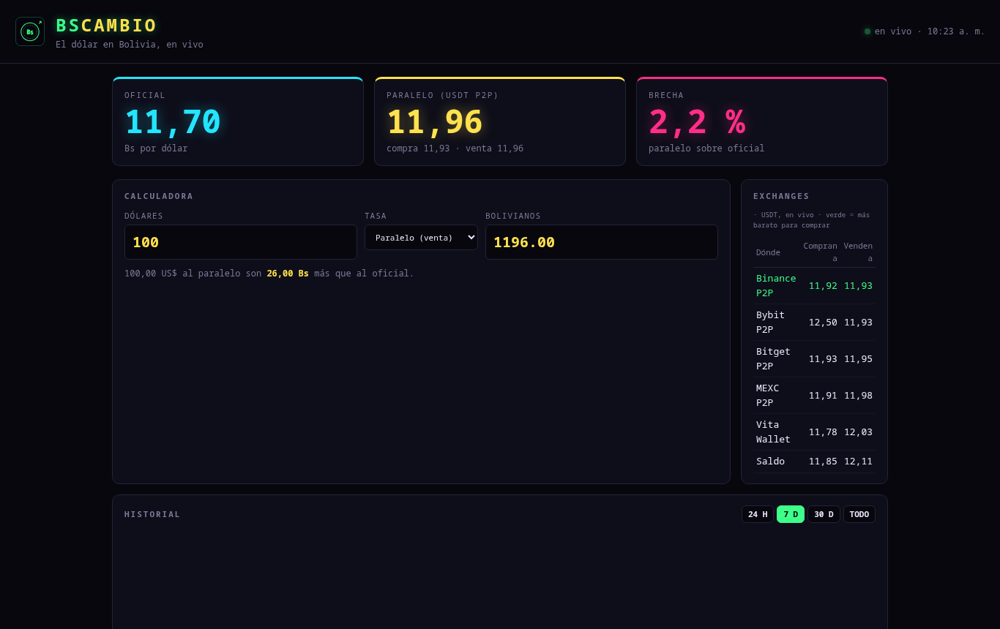

<div align="center">



### El dólar en Bolivia: oficial, paralelo y la brecha, en vivo.

<a href="https://neckhurtttt.github.io/BsCambio/"></a>




</div>

## 💵 Qué muestra

- **Oficial** y **paralelo** (USDT en Binance P2P), con la **brecha** en %.
- **Calculadora** de dólares ↔ bolivianos con la tasa que elijas, y cuánto ganas o pierdes contra el oficial.
- **Exchanges**: compra y venta en Binance, Bybit, Bitget, OKX y otros, con el más barato marcado.
- **Historial**: una GitHub Action guarda una foto **cada hora** en [`datos/historial.csv`](datos/historial.csv). Gráfico de 24 h, 7 días, 30 días o todo.
- Si no hay internet o la API se cae, muestra el último dato guardado.

## ⚙️ Cómo funciona

```
cada hora ── GitHub Action ── scripts/registrar.py ──► datos/historial.csv ──► la página
en vivo ──── bo.dolarapi.com + criptoya.com ───────────────────────────────► la página
```

```sh
python3 -I scripts/registrar.py datos   # guarda una foto
python3 -m http.server 8000             # http://127.0.0.1:8000
```

Datos: [DolarApi Bolivia](https://bo.dolarapi.com) y [CriptoYa](https://criptoya.com). Es referencial, no es asesoría financiera.

<div align="center"><sub>BSCAMBIO · hecho por <a href="https://github.com/NeckHurtttt">NeckHurtttt</a></sub></div>
